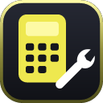

<p align="center">
  
</p>

<h1 align="center">Local Utils</h1>

<p align="center">
  Everyday utilities in one window for Windows and Linux. On Windows, a clipboard history that lives in the tray
  and a screenshot editor; on both, a system monitor, a clock, a calculator, a unit converter, developer tools, a
  scratchpad, a colour picker and an image converter. Works offline, needs no account, written in Rust.<br>
  <a href="https://github.com/Anon5T4R/Local-Utils/releases/latest">Download</a> ·
  <a href="ROADMAP.md">Roadmap and status</a> ·
  <a href="#where-it-comes-from">Where it comes from</a> ·
  <a href="#how-it-is-made">How it is made</a>
</p>

<!-- screenshot: the Clipboard tab with a few entries (text, image, file list) and the type filters above the list; dark and light -->

The clipboard history is what the app is built around: it is the part that keeps running, out of the way in
the tray, and it opens from a shortcut wherever you are. The other utilities are tabs, and each one starts
only when you open it.

## What it does

- **Clipboard.** Records what you copy: plain text, HTML, RTF, images and file lists, each with its own icon in
  the list. Search the history, filter it by type, recopy an entry or press `Enter` on it, edit a text entry,
  show its text as a QR code, pin it so retention never drops it, delete it, or clear everything that is not
  pinned. Copying the same content again moves the existing entry to the top instead of duplicating it. An
  image entry can be read as text (the OCR engine that ships with Windows). The shortcut opens a compact list at
  the cursor; choosing an entry puts it back on the clipboard and pastes it into the window that had focus.
- **Screenshot.** The shortcut freezes the desktop on every monitor, you drag the region, and the editor opens
  on the result with these tools: select and move an annotation, rectangle, arrow, text, pixelate, blur, crop,
  and undo. Copy the result to the clipboard or save it as a PNG. One capture is kept at a time; a new one
  replaces the previous.
- **System.** CPU, memory, disks, network, uptime, temperatures and the battery (read from the OS on Windows),
  plus the busiest processes with a button to end one. It reads the system only while the tab is open.
  Temperatures depend on what the machine exposes and show as unavailable when nothing does.
- **Tools.** *Clock*: timer with presets, Pomodoro, stopwatch and alarms; an alarm plays a `.wav` of your choice
  or three system beeps, and it fires even with the tab closed. *Calculator*: expressions with parentheses, `^`,
  `sqrt`, `sin`, `cos`, `tan`, `log`, `ln`, `abs`, `pi` and `e`. *Units*: length, mass, temperature, data and
  speed. *Dev tools*: Base64, URL percent-encoding, SHA-256 and MD5, UUID v4, and ISO date to and from Unix
  epoch. Copying a result adds it to the clipboard history.
- **Scratchpad.** One multiline note for the thing you have to paste somewhere; it is saved a second after you
  stop typing.
- **Colour.** Hex, RGB and HSL fields for the same colour, an eyedropper that magnifies the screen under the
  cursor (click picks, `Esc` cancels), and the colours you used recently.
- **Convert.** A queue of images, dropped on the window or picked from disk, converted to PNG, JPEG (quality
  1–100) or WebP. The type is read from the file header, not the extension; the result goes next to the
  original and never overwrites a file; a name collision gets ` (1)`, ` (2)`. Metadata is not carried over: the
  conversion starts from the pixels.

The parts that talk to the operating system directly exist on Windows only: the clipboard listener, the tray
icon, the global shortcuts, the screen capture, the eyedropper, the OCR, pasting into the window that had focus
and the alarm sound. On Linux the same app opens the other tabs, with those pieces missing. What is open or
missing is in the [roadmap](ROADMAP.md).

## Formats

- **Copies** come from the Windows clipboard formats: Unicode text, HTML, RTF, a bitmap (converted to PNG with a
  256 px thumbnail) and a file list. Recopying an entry writes the same format back.
- **The history** is `history.json` in the config folder (`%APPDATA%\local-utils` on Windows,
  `~/.config/local-utils` elsewhere): a small JSON file with a format version, written to a temporary file and
  renamed, so an interrupted write does not corrupt it. A file that cannot be read is left in place and the app
  starts with an empty list. Five hundred entries and 256 MiB of images; pinned entries count towards the limit
  but are never removed.
- **Export and import** use `.lutils`, which is the same JSON. Import merges into the current history: the same
  entry keeps the newest version, the same copy under a different id becomes one entry, and the local limits
  apply again.
- **Screenshots** are saved as PNG, at the path you pick.
- **The converter** reads PNG, JPEG, WebP and JPEG XL. JPEG XL is a source only: there is no encoder in Rust with
  a licence we can ship, so it is never a target.
- **Settings (including the global shortcuts and the list of excluded executables), the alarms, the scratchpad
  text and the recent colours** live in `config.json`, next to the history.

The history is not encrypted: it is a plain JSON file with what you copied. Copies made by the executables
listed in the settings are not recorded — password managers are in that list by default.

## Network and privacy

- What you copy, capture, type or convert never leaves the computer.
- On start the app asks GitHub whether a newer version exists; Settings has the same check on demand. It
  downloads only when you accept, from this repository's releases. Before installing an update, the app checks
  the file against the SHA-256 the release publishes; the assets also carry a minisign signature, which the
  updater verifies and currently only logs if it does not match. There is no setting to turn the check off yet.
- No account, analytics or crash reporting.

Security notes, all checkable in this repository:

- TLS for the update check and the download is pure Rust (rustls with a RustCrypto provider). The program you
  install contains no `ring`, `aws-lc` or OpenSSL.
- In the app's own code, `unsafe` appears only in calls to the Windows API: the window and tray control, the
  clipboard listener, the global shortcut, the screen capture, the OCR engine and the alarm sound.
- Releases are built by GitHub Actions from a tagged commit with locked dependencies, every dependency passes
  `cargo-deny`, and none comes from a git URL.

## Where it comes from

Local Utils is our own app, not a fork of another utility. It was scaffolded in the same shape as every Local
app — Rust, egui/eframe, one self-contained repository — and it wears the shell the suite shares: Settings,
theme and command palette in the title bar, tabs in the window, one config file.

What is not ours is vendored under `libs/`, and kept as close to its source as the app allows:

- `libs/egui` and `libs/winit` are vendored copies of our forks (egui `6d518fc`, winit `a517b38`), the same ones
  the suite uses.
- `libs/craft-libs` holds the shared crates we use — the updater (`craft-update`), the icons, the command palette,
  the translation catalogs and the desktop theme. The copies come from our `local-libs` and began as crates of the
  upstream [craft-libs](https://github.com/storytold/craft-libs) (MIT or Apache-2.0), including UI behaviour
  adapted from the upstream apps, as its [NOTICE](libs/craft-libs/NOTICE) records. Our copy of the updater is a
  deliberate fork: it carries the update paths for our packages (MSI and portable zip on Windows; AppImage,
  deb/rpm, Arch and tar.gz on Linux), our release asset names and the signing key of the suite.
- `libs/rustls-rustcrypto` is a fork of [rustls-rustcrypto](https://github.com/RustCrypto/rustls-rustcrypto)
  (MIT or Apache-2.0) for the updater's TLS. It stays at `0.0.2-alpha` because the upstream version pulls
  `rustls-webpki` 0.102 only for a few algorithm constants; the fork takes them from `rustls-pki-types` instead,
  which removes those advisories. Nothing else in the crate changed.

The first utility was the clipboard history; the rest grew around it, and each new one has to be useful once a
week, work with no network, not duplicate a sibling app and open instantly. That rule and the open items are in
the [roadmap](ROADMAP.md).

## Download

Windows 10/11 (x64): `.msi` per-machine installer (into `Program Files`, with Start Menu and Desktop shortcuts)
or a portable `.zip`. Linux (x86_64): `.AppImage`, `.deb`, `.rpm`, an Arch `.pkg.tar.zst` or a plain `.tar.gz`.
All in [Releases](https://github.com/Anon5T4R/Local-Utils/releases/latest). macOS is not published.

Files are signed with [minisign](https://jedisct1.github.io/minisign/) when the release pipeline has the signing key,
with the same key as every Local app; check that the `.minisig` file is in the release. Each release has a
`SHA256SUMS.txt`:

```sh
minisign -Vm <file> -P RWTqN+hTTCFbDCGCA1cEJRLp2FSluxIUiJfqdoAYwkwNNVH5MTYH8qSN
```

The public key is also in [packaging/minisign.pub](packaging/minisign.pub).

## How the app is built

One Cargo package holds the whole app. The forks and shared crates it builds from source are vendored next to
it; everything else comes from crates.io, pinned by the committed lock.

| Part | What it holds |
|---|---|
| `src/` | the window and its tabs, the clipboard engine and history, screen capture and the screenshot editor, the system monitor, the tools, the scratchpad, the colour picker, the image converter and the settings |
| `libs/` | the forks and mirrors built from source: egui and winit, the shared `craft-libs` crates, the TLS provider |
| `xtask/` | the local checks (`cargo xtask ci`) and the version bump |
| `i18n/locales/` | the interface translations, one TSV per language; English is the source |
| `packaging/` | the MSI and portable zip for Windows; AppImage, deb, rpm and tarball for Linux; the Arch `PKGBUILD` |

The clipboard history is a plain module with no call into the operating system, which is why its tests run on
every platform: the OS side (`src/clipboard.rs`) only reads and writes the clipboard and hands entries over.
The clipboard listener, the tray icon and the global shortcut each run on their own thread and report through a
channel that the window drains at the top of every frame; the tabs are drawn in the frame and hand their changes
back to the app.

## How it is made

Local Utils follows the same rules as every Local app: local files and no account, Rust only (including the UI
and the cryptography), one self-contained repository per app, governed dependencies, and signed releases built
from a tag. Most of the code is written by AI coding agents (Claude Code and OpenCode) from written plans,
reviewed by the maintainer and held to the same checks and CI. The reasons for each decision:
[How we make the Local apps](https://github.com/Styx-Studios/.github/blob/main/profile/README.md#how-we-make-the-local-apps).

## Build from source

```sh
git clone https://github.com/Anon5T4R/Local-Utils
cd Local-Utils
cargo run --release        # the app
cargo xtask ci             # all local checks
```

A recent stable Rust toolchain is enough. On Linux, install the system packages the CI workflow lists
([.github/workflows/ci.yml](.github/workflows/ci.yml)); the release workflow has its own list
([release.yml](.github/workflows/release.yml)).

## Keyboard shortcuts

`Ctrl+K` opens the command palette: every tab, the actions of the app, the themes, Settings, updates and exit.
The global shortcuts are `Win+Alt+V` for the clipboard and `Win+Alt+S` for the screen capture. In the clipboard
list, the arrows move, `Enter` copies, `Delete` removes the focused entry and `Esc` clears the search.

Both global shortcuts live in `config.json`; the clipboard one can also be recorded in Settings, while the
capture one is still edited in `config.json` only.

## The Local apps

[Local Word](https://github.com/Anon5T4R/local-office) ·
[Local Sheets](https://github.com/Anon5T4R/local-sheets) ·
[Local Slides](https://github.com/Anon5T4R/local-slides) ·
[Local PDF](https://github.com/Anon5T4R/local-pdf) ·
[Local Keys](https://github.com/Anon5T4R/Local-Keys) ·
[Local Image](https://github.com/Anon5T4R/Local-Image) ·
[Local Photo](https://github.com/Anon5T4R/Local-Photo) ·
[Local Paint](https://github.com/Anon5T4R/Local-Paint) ·
[Local Vector](https://github.com/Anon5T4R/Local-Vector) ·
[Local Player](https://github.com/Anon5T4R/Local-Player) ·
[Local Notebook](https://github.com/Anon5T4R/Local-Obsidian) ·
[Local Mindmap](https://github.com/Anon5T4R/Local-Mind) ·
[Local Utils](https://github.com/Anon5T4R/Local-Utils)

## License and credits

MIT or Apache-2.0, at your option ([LICENSE-MIT](LICENSE-MIT), [LICENSE-APACHE](LICENSE-APACHE)). The vendored
crates keep their authors' licences and notices under `libs/` — `libs/craft-libs` carries its own
[NOTICE](libs/craft-libs/NOTICE) and [ATTRIBUTION](libs/craft-libs/ATTRIBUTION.md).
